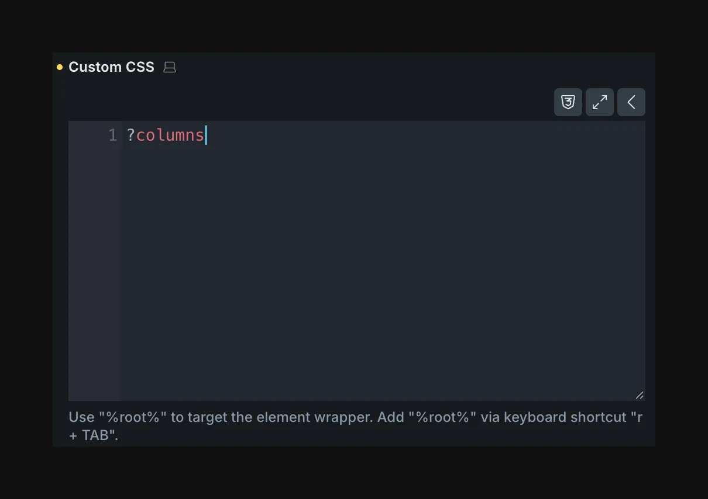

Recipes are a feature in ACSS since v3.0. Type a `?` shortcut in a CSS field and it expands into ready-made CSS. They work without any dashboard setting.

## What’s a Recipe?

A Recipe is a block of CSS that you can use wherever needed. It works similar to how a [SCSS mixin](../mixins/what-are-mixins.md) works, but instead of just referencing the block of CSS, the Recipe functionality fully exposes the underlying code.

For example, let’s say you want to turn a big block of paragraphs into a multi-column layout. In ACSS, you could do this with our [Columns utilities](../columns/css-columns.md). The downside is that you need to use utility classes, which aren’t always appropriate.

Columns functionality is not something that can be mapped to a CSS variable, so there was no other option for creating columns without writing the CSS yourself, prior to Recipes.

With Recipes, you simply open the rich text element that houses your paragraphs, create a class if you want to assign the Recipe to a class, and then type “?” plus the name of the recipe:



Calling a Recipe in ACSS

Close the line with “;” just as you normally would and the Recipe will appear instantly:

Expanded version of a Recipe in ACSS

Some recipes are very simple and some are complex. It just depends on the utility that you happen to be expanding.

## Recipes in Bricks and Gutenberg <Since version="4.0.2" /> {#where-recipes-work}

ACSS recipes work in Bricks and Gutenberg as soon as you type `?` in a CSS input. No setting is needed. **Options → Workflow Enhancements → Variable Expansion & Validation** only adds auto-corrections such as `var()` and `calc()` expansion.

Etch has its own built-in recipes and doesn't use the ones on these pages.

New in 4.0.2: the flex recipes (`?flex-grid`, `?center-*`), the gradient recipes, `?tooltip`, `?footer-reveal`, `?color-mix`, `?transparency`, `?font-face`, `?is-bg`, `?skip-link`, `?fade-all`, `?concentric-radius-reverse`, `?border-check` and the pseudo recipes (`?::before`, `?::after`, `?:hover`, `?:focus-visible`, `?hover-exclude-touch`). Recipe names can't contain spaces, so the combined pseudo recipes are `?::before,::after` and `?:hover,:focus-visible`.

Changed in 4.0.2: `?columns`, `?concentric-radius`, `?variable-grid` and the divider recipes have new defaults. Each recipe page lists what changed.

### How recipes expand in Bricks and Gutenberg

Short recipes like `?flex-row`, `?grid-3` or `?center-all` expand to plain declarations. Type them inside the rule you want to style:

```css
%root% {
  ?center-all;
}
```

Recipes with nested rules, like `?auto-grid`, `?flex-grid` or `?fade-top`, expand to a complete `%root% { … }` block. Type them on their own line and edit the values inside the expanded block. Bricks replaces `%root%` with the element's selector.

## Using Recipes in Input Fields

Some Recipes are simply the exposed value of a specific variable and can be used as single values in input fields. For example, the Recipe `?[color-name]-clr` exposes a color with all its channels.

Let’s say you want a custom transparency or a tweaked version of an existing color. Type `?primary-clr` and hit Enter. The Recipe expands to:

```CSS
oklch(from var(--primary) l c h / 1)
```

Now you can change the transparency value or any of the lightness (`l`), chroma (`c`) and hue (`h`) channels, for example with `calc()`. See [Color Recipes](color-recipes.md).

Because the expansion starts from `var(--primary)`, whatever you don’t edit stays hooked into the ACSS system, so it updates when you change your colors in the dashboard.

## Recipes & Stylesheet Efficiency

For users who want to turn off sets of utility classes, Recipes can be a great way to continue accessing the functionality of those utilities on a case-by-case basis.

Using our example above, you could turn off “Columns” classes in ACSS, which removes all the columns utilities from the stylesheet (making your stylesheet lighter). If you need columns on your project, you cans simply use `?columns` to get the functionality wherever its needed without having to load all the columns utilities.

## The future of Recipes

ACSS 3.0 ships with some initial Recipes for popular non-variable-driven utilities ([columns](../columns/css-columns.md), [masonry](../columns/masonry-layouts.md), [clickable parent](../accessibility/clickable-parent.md), [focus parent](../accessibility/focus-parent.md), [flex-grid](../flexbox/flex-grids.md), color expansion, and more). We’ll quickly expand Recipes functionality to all utilities that will provide great value to the user.

In addition to pre-configured Recipes provided by the framework, we have plans to allow for custom Recipes and Recipe-sharing. You’ll be able to write and save your own Recipes and import/export those recipes between sites. You can also share Recipes or groups of Recipes with other users (in the future).

Recipes introduce a big leap forward in workflow efficiency that we’re proud to bring to the ACSS ecosystem.
