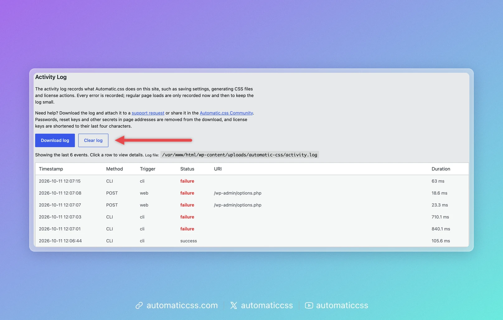
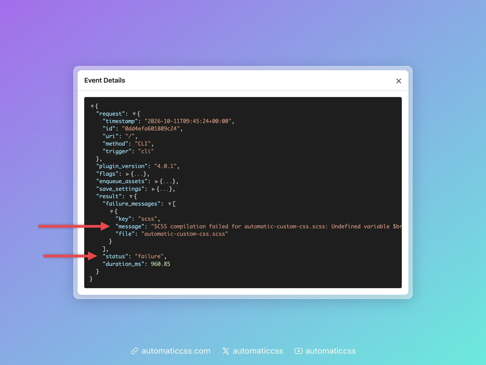

Automatic.css keeps an activity log of what it does, for example generating your CSS files. When something does not work, for example your changes don't show up on the site, the activity log is the first place to look. It tells you whether Automatic.css ran into an error and what the error was.

## Open the activity log

1. In the WordPress admin, open **Automatic CSS** in the menu.
2. Click the **Activity Log** tab.

You need to be an administrator to see it.



The tab shows the last 50 events, newest first:

| Column | What it means |
| --- | --- |
| **Timestamp** | When it happened. |
| **Method** | The HTTP method of the request, such as `GET` or `POST`, or `CLI` for WP-CLI commands. |
| **Trigger** | What started it: `web` for a normal page load, `ajax` for requests from the dashboard (for example saving), `rest` for the REST API, `cron` for scheduled WordPress tasks, `cli` for WP-CLI. |
| **Status** | `success`, or `failure` in red when something went wrong. |
| **URI** | The address of the request. |
| **Duration** | How long Automatic.css took. |

:::tip Only some successful events are logged
To keep your site fast, Automatic.css logs every error but only about 1 in 100 successful requests. A short log with few entries is normal and means nothing went wrong.
:::

## See what went wrong

Click a row to open its **Event Details**. For a failed event, look at `result`:

- `status` says `failure`.
- `message` under `failure_messages` describes the error, for example which file failed and where.



The arrows (▼ and ▶) fold and unfold the sections. Sections such as `flags` and `save_settings` contain a lot of technical detail you usually don't need.

In the example above, the Global SCSS uses a variable that doesn't exist (`$brand-colour`), so the CSS could not be generated. Fix the code in the dashboard, save, and the next event shows `success`.

## Send it to support

If you can't solve the error yourself, [contact support](https://digitalgravy.co/support) and include:

- a screenshot of the **Event Details** window with the `result` section unfolded, and
- the date and time of the event, and what you did just before it.

If support asks for the whole log, send the file shown next to **Log file** on the Activity Log tab (`activity.log`). You can download it with your host's file manager or SFTP.

The log contains technical details about your site, such as addresses and Automatic.css settings. Only share it with support.

## If the log is empty or missing

- **"The activity log is empty."** Nothing has been logged yet. That's normal on a site without errors.
- **"No activity log file found."** The log is created with the first event. If it stays missing, check that the `ENABLE_ACTIVITY_LOG` flag is on, for example with [`wp acss flags list`](../cli/flags.md). It is on by default.

## Using WP-CLI

You can read and clear the log from the command line as well:

```bash
wp acss logs tail
wp acss logs clear
```

See [`wp acss logs`](../cli/logs.md) for all options. [`wp acss doctor`](../cli/doctor.md) also checks the log for recent errors.
