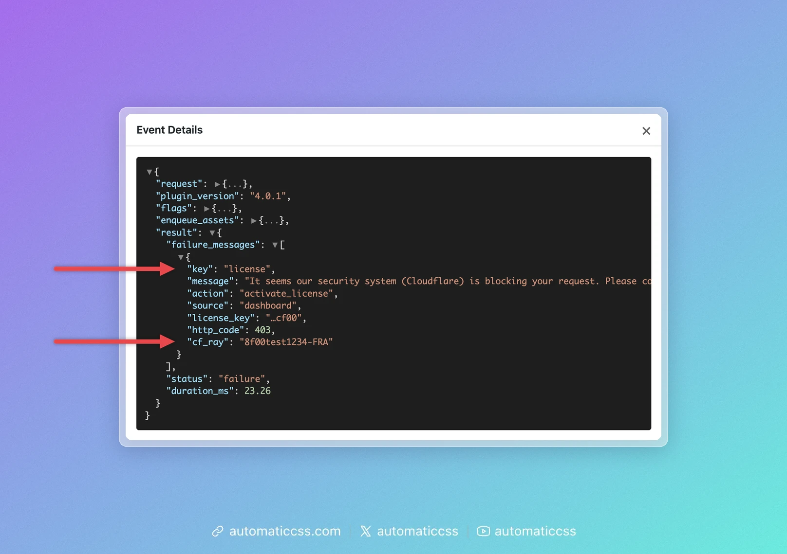

Automatic.css keeps an activity log of what it does, for example generating your CSS files or activating your license. When something does not work, for example your changes don't show up on the site or your license won't activate, the activity log is the first place to look. It tells you whether Automatic.css ran into an error and what the error was.

## Open the activity log

1. In the WordPress admin, open **Automatic CSS** in the menu.
2. Click the **Activity Log** tab.

You need to be an administrator to see it.


The tab shows the last 50 events, newest first:

| Column | What it means |
| --- | --- |
| **Timestamp** | When it happened. |
| **Method** | The HTTP method of the request, such as `GET` or `POST`, or `CLI` for WP-CLI commands. |
| **Trigger** | What started it: `web` for a normal page load, `ajax` for requests from the dashboard (for example saving), `rest` for the REST API, `cron` for scheduled WordPress tasks, `cli` for WP-CLI. |
| **Status** | `success`, or `failure` in red when something went wrong. |
| **URI** | The address of the request. |
| **Duration** | How long Automatic.css took. |

:::tip Only some successful events are logged
Automatic.css logs every error, but only some of the requests that went fine, so the log stays small and your site stays fast. A short log with few entries is normal and means nothing went wrong.
:::

## See what went wrong

Click a row to open its **Event Details**. For a failed event, look at `result`:

- `status` says `failure`.
- `message` under `failure_messages` describes the error, for example which file failed and where.


The arrows (▼ and ▶) fold and unfold the sections. Sections such as `flags` and `save_settings` contain a lot of technical detail you usually don't need.

In the example above, the Global SCSS uses a variable that doesn't exist (`$brand-colour`), so the CSS could not be generated. Fix the code in the dashboard, save, and the next event shows `success`.

### License errors

When activating or deactivating your license fails, the event shows `"key": "license"` under `failure_messages`. The `message` is the same one you saw on the **License** tab. The other fields tell support why it failed:



| Field | What it means |
| --- | --- |
| `action` | `activate_license` or `deactivate_license`. |
| `source` | Where you started it: `dashboard` (the **License** tab), `cli` (WP-CLI), or `legacy_release` (Automatic.css removing the old Automatic.css 3 license after an upgrade). |
| `license_key` | Only the last four characters of the key, for example `…cf00`. |
| `edd_error` | The reason the licensing server gave, for example `no_activations_left` or `expired`. |
| `http_code` | Shown when the licensing server answered with an error, for example `403`. |
| `cf_ray` | Shown when Cloudflare blocked the request. Support needs this Ray ID to find the block. |
| `transport_error` | Shown when your site could not reach the licensing server at all, for example because of a firewall or a timeout. |

## Share it to get help

If you can't solve the error yourself:

1. Click **Download log** on the Activity Log tab. Your browser saves a file named like `acss-activity-log-2026-10-11.log`.
2. Attach the file to a [support request](https://digitalgravy.co/support/), or share it in the [Automatic.css Community](https://community.automaticcss.com/).
3. Add the date and time of the problem and what you did just before it.

Before the file is downloaded, Automatic.css removes passwords, password reset keys, logins, tokens and nonces from page addresses. License keys are shortened to their last four characters. The file still contains technical details about your site, such as page addresses and your Automatic.css settings. If you'd rather not share those in public, send the log through a support request instead of the Community.

:::note Older versions
Automatic.css versions without the **Download log** button keep the file in `wp-content/uploads/automatic-css/activity.log`. You can download it with your host's file manager or SFTP.
:::

## Clear the log

Click **Clear log** and confirm. This empties the log, including older rotated files, and cannot be undone. Clearing helps when you want to reproduce a problem: clear the log, repeat the steps that fail, and then download a log that only contains that attempt.

## If the log is empty or missing

- **"The activity log is empty."** Nothing has been logged yet. That's normal on a site without errors.
- **"No activity log file found."** The log is created with the first event. If it stays missing, check that the `ENABLE_ACTIVITY_LOG` flag is on, for example with [`wp acss flags list`](../cli/flags.md). It is on by default.

## Using WP-CLI

You can read and clear the log from the command line as well:

```bash
wp acss logs tail
wp acss logs clear
```

See [`wp acss logs`](../cli/logs.md) for all options. [`wp acss doctor`](../cli/doctor.md) also checks the log for recent errors.
