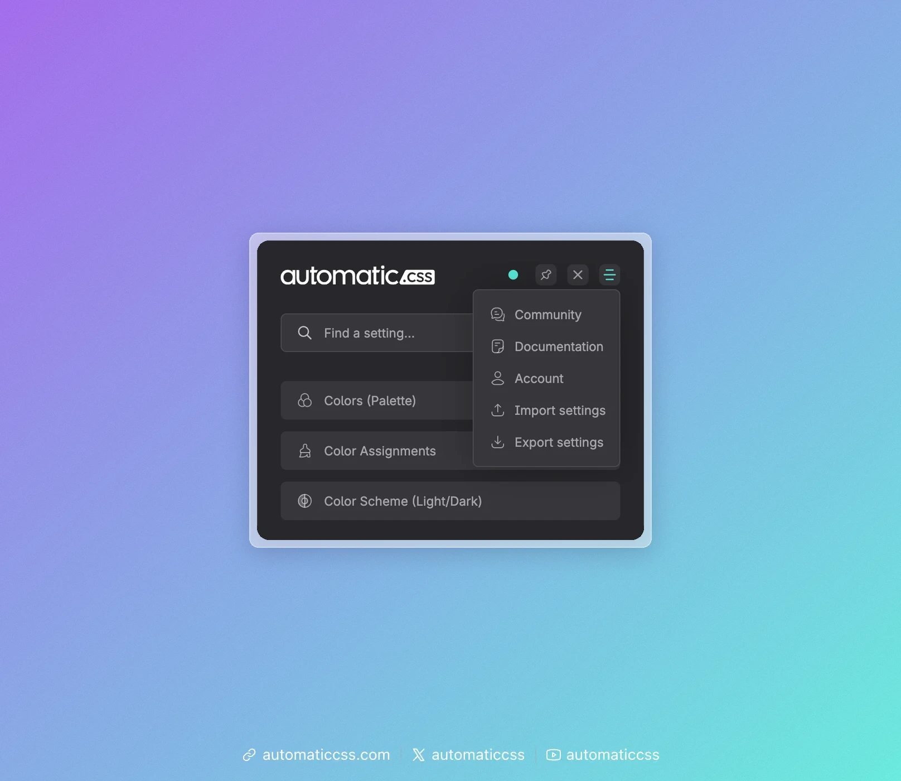
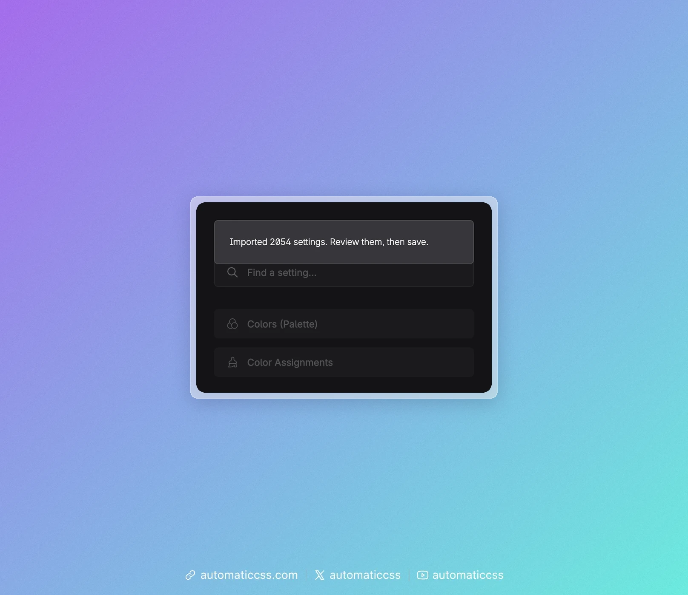
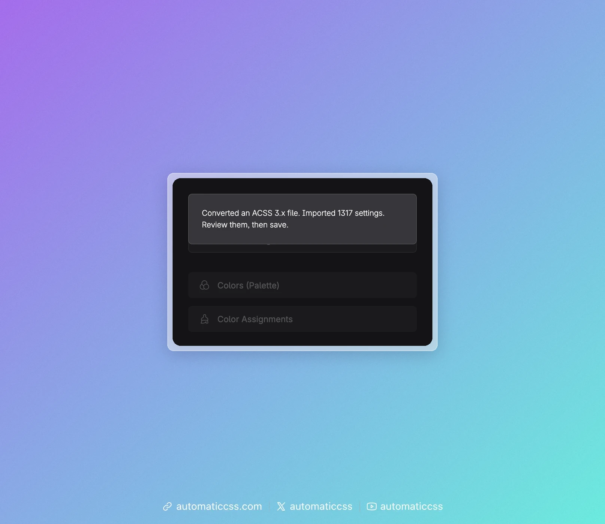
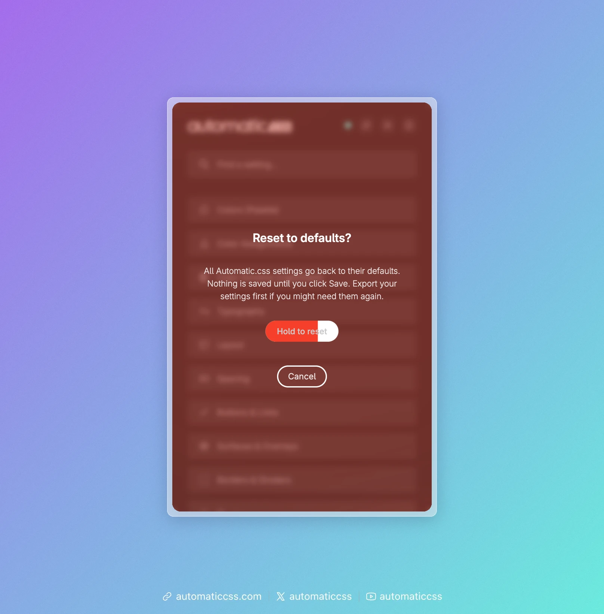
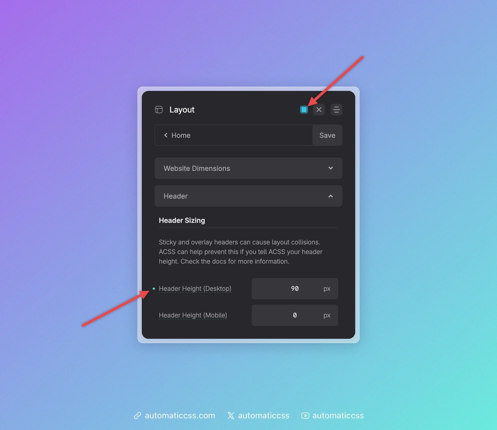
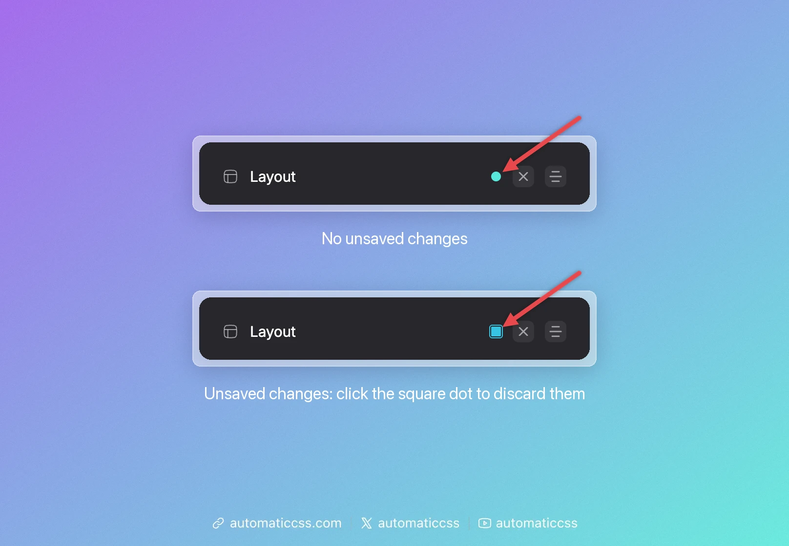
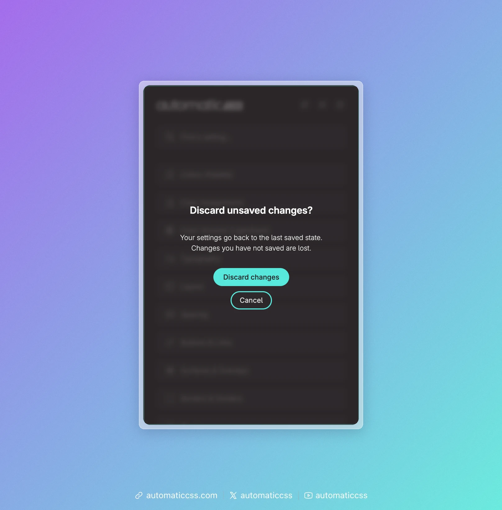

You can move your Automatic.css settings between sites, or keep a copy of them, by exporting them as a JSON file and importing that file on another site. You can also reset all settings to the Automatic.css defaults, or discard changes you have not saved yet. Import, export and reset live in the dashboard's header menu. Further down, you'll also find what the dots in the dashboard mean.



## Export your settings

1. Open the Automatic.css dashboard on the site's front end or in your builder. The keyboard shortcut <kbd>CMD</kbd> + <kbd>SHIFT</kbd> + <kbd>O</kbd> (<kbd>CTRL</kbd> + <kbd>SHIFT</kbd> + <kbd>O</kbd> on Windows) opens it too, unless you changed it in the dashboard's Options screen.
2. Click the menu icon in the top right corner of the dashboard.
3. Click **Export settings**.

Your browser downloads a file named `acss-settings-YYYY-MM-DD.json`. The file contains the values you currently see in the dashboard, including changes you have not saved yet.

## Import settings

1. Open the dashboard on the site that should receive the settings.
2. Click the menu icon in the top right corner of the dashboard.
3. Click **Import settings** and choose the JSON file.
4. Review the imported values, then open any settings screen and click **Save**.



Imported values are not saved right away. They show up as unsaved changes, so you can look at the result first. If you reload the page without saving, the import is discarded.

Settings that are not in the file keep their current values. Values in the file that this version of Automatic.css does not know are skipped.

## Importing a file from ACSS 3.x

You can import a settings file that was exported from an ACSS 3.x site. Automatic.css recognizes the file and converts its colors and other settings to the 4.x format before staging them.



:::warning This only converts the file
Importing a 3.x settings file does not upgrade a site from ACSS 3.x to 4.x, and it does not make 3.x content compatible with 4.x. We still recommend leaving existing 3.x sites on 3.x. See [What's New in ACSS 4.x](whats-new-in-4.md) for the differences.
:::

Settings that no longer exist in 4.x are skipped. Always review the result before you save.

## Reset to defaults

1. Open the dashboard and click the menu icon in the top right corner.
2. Click **Reset to defaults**. A warning covers the dashboard.
3. Press and hold **Hold to reset** until the button is filled, about one and a half seconds. Holding <kbd>Space</kbd> or <kbd>Enter</kbd> works too. A short click is not enough: if you let go early, nothing is reset and a hint reminds you to keep holding.
4. Review the result, then open any settings screen and click **Save**.



Click **Cancel** or press <kbd>Esc</kbd> to close the warning without resetting.

Like an import, the reset is not saved right away. Until you click **Save**, you can undo it by reloading the page. If you might need your current settings again, export them before you reset.

## The dots in the dashboard

The dashboard uses two kinds of dots to show what has changed. They look alike, but they mean different things.



### Next to the logo or the screen title: unsaved changes

- **Round dot:** there are no unsaved changes.
- **Square dot:** you have changed something that is not saved yet. Click **Save** to keep it, or click the dot to discard it (see [Discard unsaved changes](#discard-unsaved-changes)).

### Next to a setting: changed from the default

A small dot to the left of a setting's name means that its value differs from the Automatic.css default. In the screenshot above, Header Height (Desktop) has a dot, Header Height (Mobile) does not. The dot stays after you save, so you can always see which settings you have customized.

When you point at the dot, it turns into a small ×. Click it to reset only this setting to its default. Like any other change, this is not saved until you click **Save**.

## Discard unsaved changes

As soon as you change something, the dot next to the logo or the screen title turns from round to square. It stays square until you save or discard your changes.



To go back to your last saved settings:

1. Click the square dot. When you point at it, its tooltip says **Discard unsaved changes**.
2. Click **Discard changes**, or **Cancel** to keep editing.



All changes you have not saved are lost, including an import or a reset you have not saved yet. Your saved settings stay as they are.

## Import & Export in the WordPress admin

The **Import & Export** tab on the Automatic.css settings page in the WordPress admin no longer has its own form. It points you to the dashboard menu described above.

## Using WP-CLI

You can also export, import and reset settings from the command line, for example during deployments:

```bash
wp acss settings export --file=acss-settings.json
wp acss settings import acss-settings.json
wp acss settings reset
```

See [`wp acss settings`](../cli/settings.md) for all options. Unlike the dashboard, `import` and `reset` save right away.
