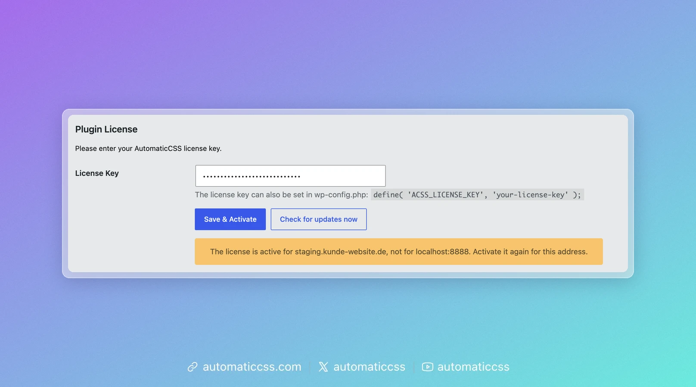
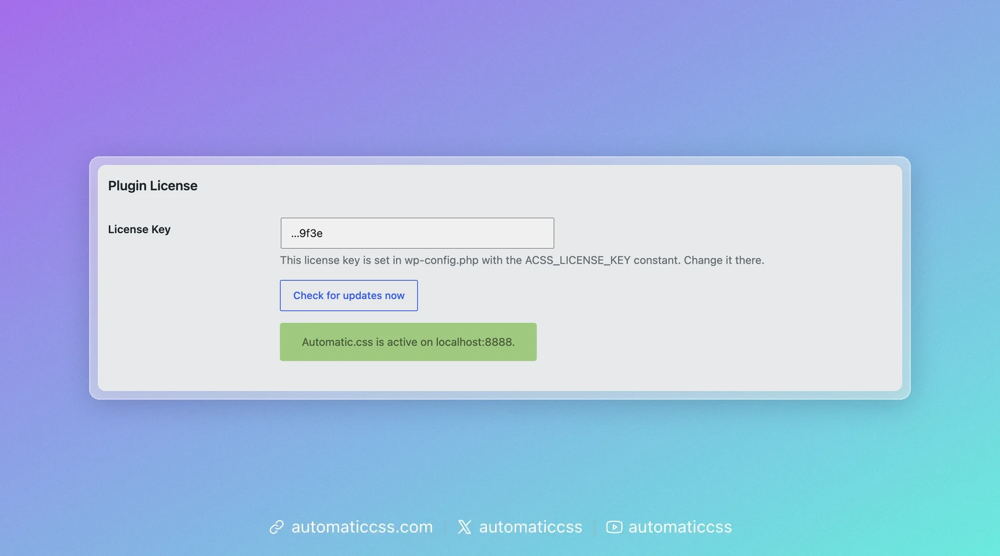

Your license key gives the site automatic updates. You manage it on the **License** tab under **Automatic CSS** in the WordPress dashboard.

## Activate your license

1. Copy the key named “–Automatic.css” from your [account](https://automaticcss.com/account). Don’t use the bundle key or the key named after your plan.
2. Paste it into **License Key**.
3. Click **Save & Activate**.

The tab shows the button that fits the current state: **Save & Activate** while the license is not active, **Delete & Deactivate** once it is. **Check for updates now** is always there.

When the license is active, the tab names the address it is active for, for example “Automatic.css is active on example.com.”

## After a domain change <Since version="4.0.2" /> {#after-a-domain-change}

A license is activated for one address. When you move a site, for example from staging to the live domain, the license is not active for the new address until you activate it again.

The License tab tells you when this happened:



Click **Save & Activate** to activate the license for the new address. The old address keeps its activation. If you need it elsewhere, remove it in your [account](https://automaticcss.com/account).

## Set the key in wp-config.php <Since version="4.0.2" /> {#set-the-key-in-wp-configphp}

If you manage many sites, you can set the key in `wp-config.php` instead of the dashboard. Add this line above `/* That's all, stop editing! */`:

```php
define( 'ACSS_LICENSE_KEY', 'your-license-key' );
```

Automatic.css then:

- uses this key instead of a key saved on the License tab;
- activates it the next time an administrator opens the WordPress dashboard;
- activates it again after you change the key or move the site to another domain;
- deactivates the key it replaced, so that key does not keep using one of your activations.

The License tab shows only the last four characters of the key and no **Delete & Deactivate** button:



To change the key, edit `wp-config.php`. To stop using it, remove the line; the License tab then works as before.

If the activation fails, the reason is in the [Activity Log](activity-log.md). Automatic.css does not retry a key the license server rejected until you change it, and retries after 10 minutes if the license server could not be reached. You can also click **Activate** to try again.

:::note WP-CLI
While the key is set in `wp-config.php`, `wp acss license set` and `wp acss license deactivate` stop with a message instead of changing it. See [wp acss license](../cli/license.md).
:::

## Check for updates <Since version="4.0.2" /> {#check-for-updates}

**Check for updates now** asks the license server for the latest version right away, instead of waiting for WordPress to check. The result appears on the tab:

- **Green:** Automatic.css is up to date, or a new version is ready to install on the Plugins page.
- **Yellow:** something needs your attention, for example no license key is saved or the license server did not provide a download for this site.
- **Red:** the license server could not be reached. A firewall or Cloudflare may be blocking the connection.

## Deactivate your license

Click **Delete & Deactivate** to remove the key from this site and free its activation, for example before you take a site down.
