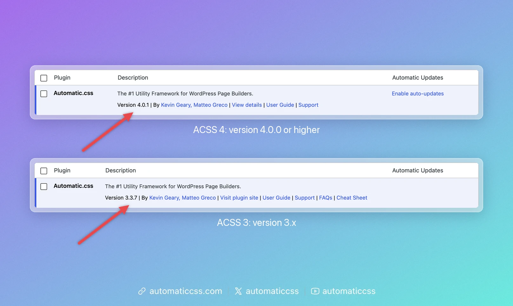
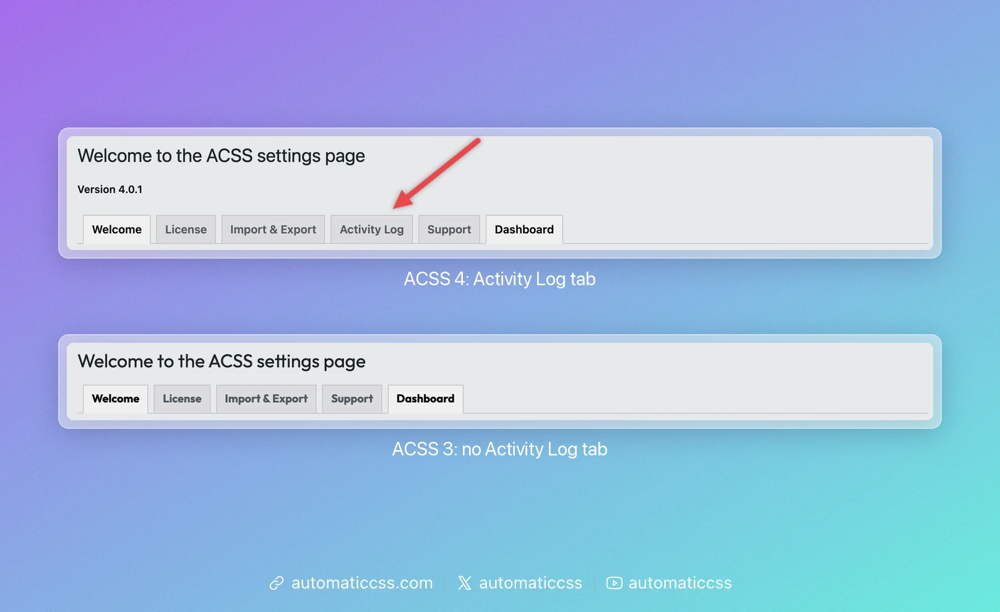
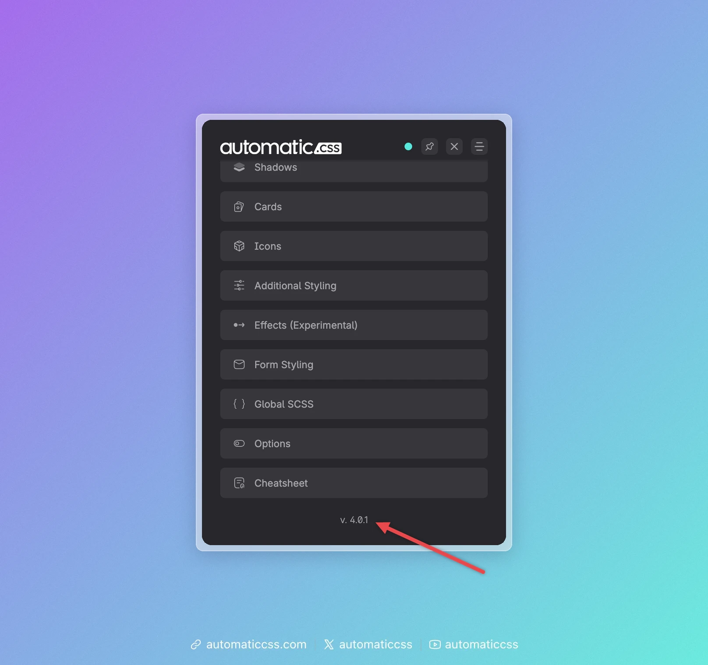

These docs exist for two versions of Automatic.css: **ACSS 4** and **ACSS 3**. They work differently, so make sure you read the docs for the version your site runs.

You can always see which docs you are reading: the colored switch in the top right corner and the line above each page say **ACSS 4** (turquoise) or **ACSS 3** (violet).

## Check your version in the plugin list

1. In the WordPress admin, open **Plugins → Installed Plugins**.
2. Find **Automatic.css**.
3. Look at the line below its description. It starts with **Version**.

| The version starts with | Your site runs | Read |
| --- | --- | --- |
| **4** (for example 4.0.1) | ACSS 4 | the **ACSS 4** docs |
| **3** (for example 3.3.7) | ACSS 3 | the **ACSS 3** docs |

## Other ways to tell

**The Automatic.css settings page.** In the WordPress admin, open **Automatic CSS** in the menu. ACSS 4 has an **Activity Log** tab, ACSS 3 does not. From ACSS 4.0.2, the page also shows the version below its title.

**The ACSS 4 dashboard.** Open the dashboard on your site's front end and scroll to the bottom of its home screen. ACSS 4 shows its version there, for example `v. 4.0.1`.

## Switch the docs version

Use the switch in the top right corner, or the "Switch to the ACSS … docs" link above each page. It opens the same page in the other version when that page exists there.

## Using both versions

ACSS 3 keeps working on existing sites. Start new sites with ACSS 4. Classes, variables and settings differ between the two versions, so code from one version's docs doesn't always work on a site running the other.
